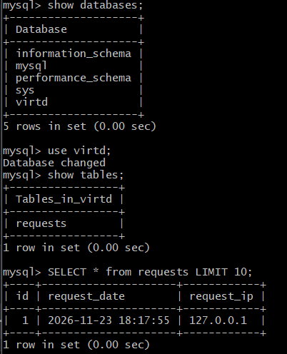
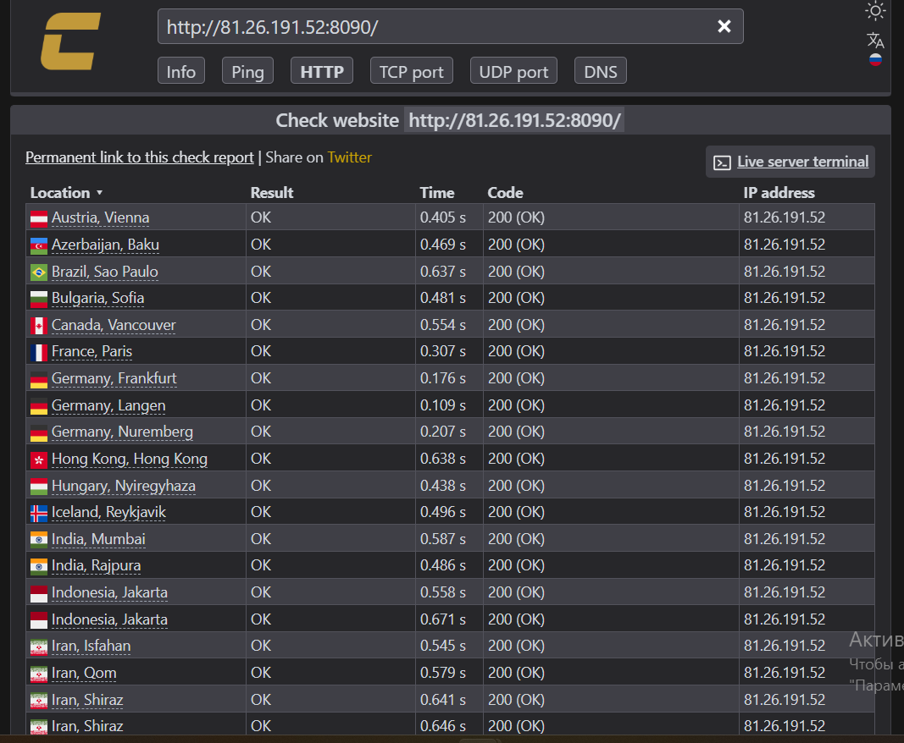
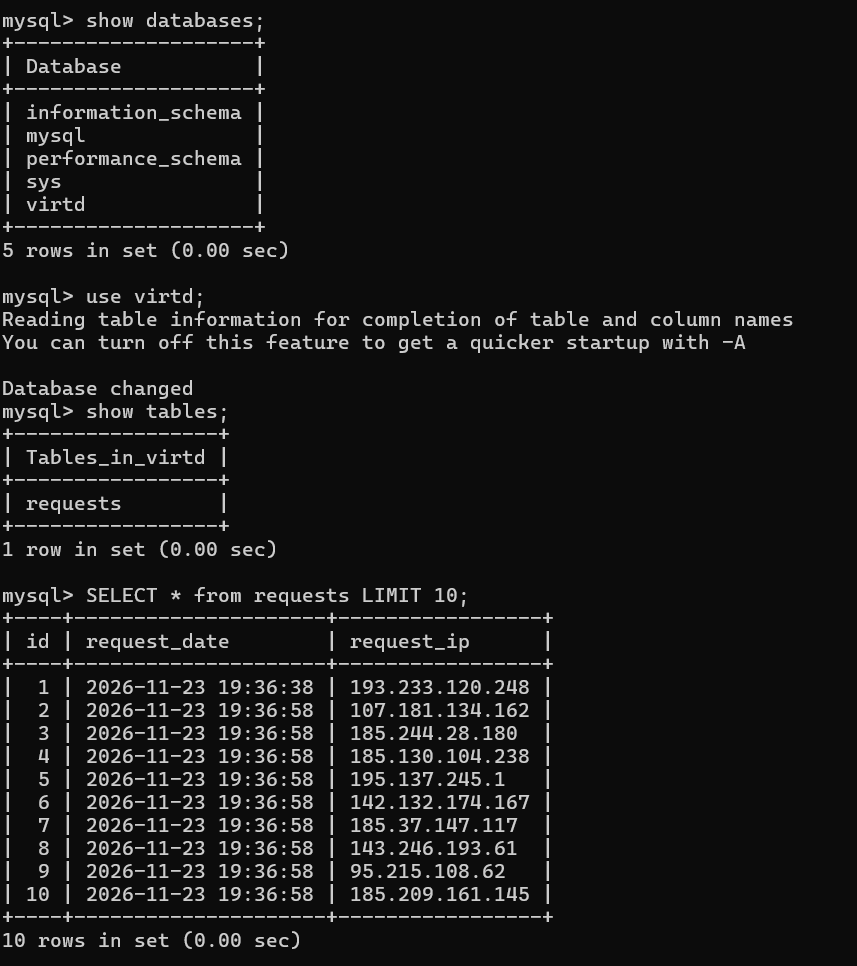

# Отчёт о выполнении домашнего задания «Практическое применение Docker»

## Ссылка на форк-репозиторий
https://github.com/stepnoy2005/shvirtd-example-python

---
## Задача 1
* Создан форк репозитория.
* Добавлен `.dockerignore` для исключения служебных файлов.
* Создан многоэтапный (multistage) [`Dockerfile.python`](Dockerfile.python) на базе `python:3.12-slim`.

---

## Задача 3
* Создан файл [`compose.yaml`](compose.yaml), подключающий [`proxy.yaml`](proxy.yaml) через директиву `include`.
* Настроены сервисы `web` (`172.20.0.5`) и `db` (`172.20.0.10`) в сети `backend` с использованием переменных из `.env`.

### Результат SQL-запроса (локальный запуск)

---

## Задача 4
* Развёрнута ВМ в Yandex Cloud, установлен Docker и Docker Compose.
* Написан и выполнен скрипт автоматического развёртывания [`deploy.sh`](deploy.sh).

### Проверка доступности сервиса через check-host.net

### Результат SQL-запроса на сервере в Yandex Cloud

